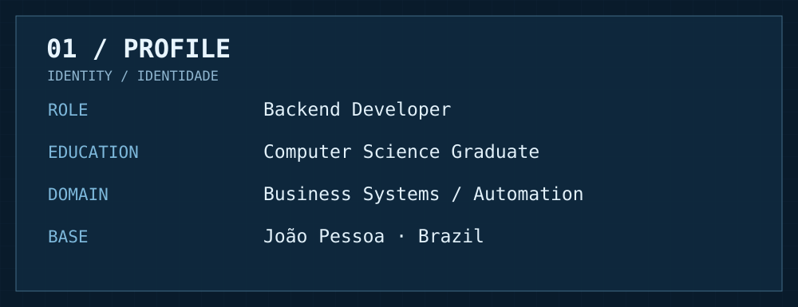
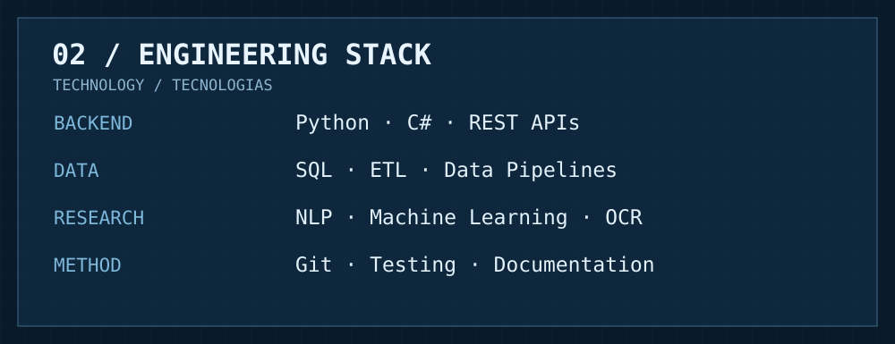
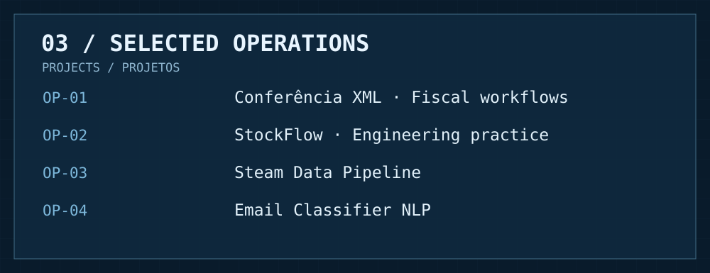
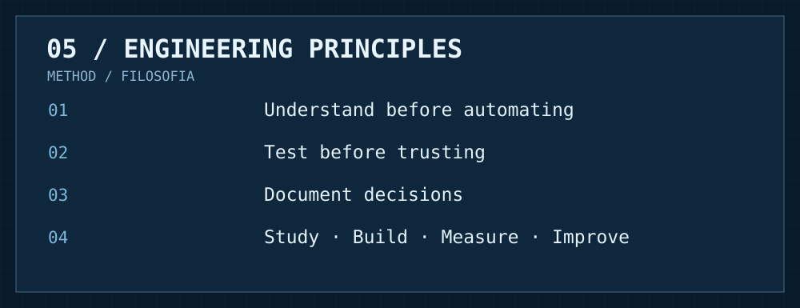

  

  

**EN** — I develop backend solutions and explore how automation, data engineering and applied AI can improve real business processes.

**PT** — Desenvolvo soluções back-end e estudo como automação, engenharia de dados e IA aplicada podem melhorar processos empresariais reais.

  

  

**Selected work / Projetos selecionados**

| Project | Engineering focus |
|:--|:--|
| **Conferência XML** · private | Fiscal document workflows / Conferência de documentos fiscais |
| **StockFlow** · private | Inventory-focused engineering practice / Estudo de engenharia para estoque |
| [**Steam Data Pipeline**](https://github.com/KevinL284/steam_data_pipeline) | Data extraction and processing / Extração e processamento de dados |
| [**Email Classifier NLP**](https://github.com/KevinL284/EmailClassificadorNLP) | Natural language processing / Processamento de linguagem natural |

  

**Experience & research / Experiência e pesquisa**

**EN** — Experience with operational and fiscal workflows, ERP environments and data organization. Research interests include NLP, OCR, machine learning and software architecture. My goal is to turn domain understanding into maintainable systems.

**PT** — Vivência em processos operacionais e fiscais, ambientes ERP e organização de dados. Interesses em PLN, OCR, aprendizado de máquina e arquitetura de software. Meu objetivo é transformar conhecimento de negócio em sistemas sustentáveis.

  

**STUDY · BUILD · TEST · IMPROVE**  
*Estudar · Construir · Testar · Melhorar*

