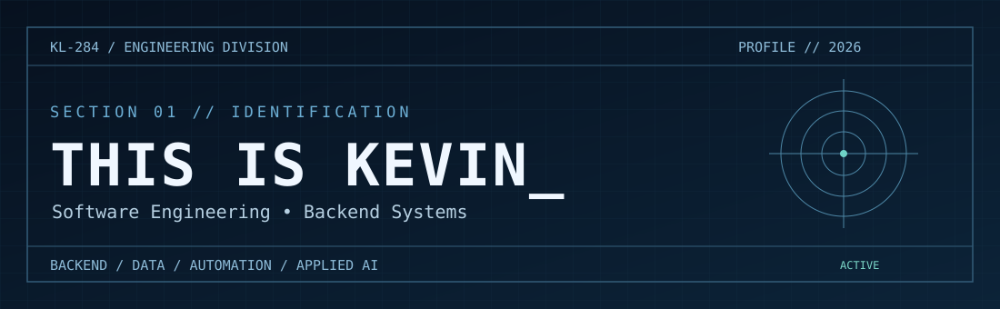
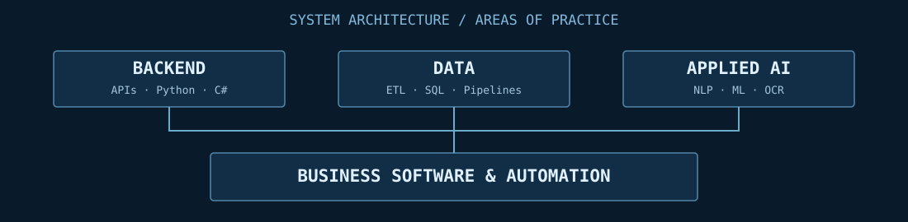

  

  **Computer Science Graduate · Backend Developer · Software Engineering**  
  **Graduado em Ciência da Computação · Desenvolvedor Back-end · Engenharia de Software**

  [Repositories / Repositórios](https://github.com/KevinL284?tab=repositories) · [Contact / Contato](#10--contact--contato)

---

### `01 / IDENTIFICATION — IDENTIDADE`

**EN** — I'm Kevin, a Computer Science graduate interested in building dependable backend systems, automating business processes and applying data and AI to real problems. I value clean interfaces between components, measurable results and deliberate engineering decisions.

**PT** — Sou Kevin, graduado em Ciência da Computação, com interesse em construir sistemas back-end confiáveis, automatizar processos empresariais e aplicar dados e IA a problemas reais. Valorizo componentes bem definidos, resultados mensuráveis e decisões técnicas fundamentadas.

`STATUS: ACTIVE` · `MODE: BUILD / TEST / LEARN` · `LOCATION: BRAZIL`

### `02 / ABOUT — SOBRE MIM`

- **EN:** Backend development, business automation, software architecture and data processing.
- **PT:** Desenvolvimento back-end, automação empresarial, arquitetura de software e processamento de dados.
- **EN:** Experience with operational and fiscal workflows, ERP environments and data transformation.
- **PT:** Experiência com rotinas operacionais e fiscais, ambientes ERP e transformação de dados.
- **EN:** Interested in AI, machine learning, NLP and practical software research.
- **PT:** Interesse em IA, aprendizado de máquina, PLN e pesquisa aplicada em software.

### `03 / TECH STACK — TECNOLOGIAS`

| Layer / Camada | Tools & practices / Ferramentas e práticas |
|:--|:--|
| **Backend** | Python · C# · APIs · REST |
| **Data** | SQL · ETL · Data pipelines · Data validation |
| **AI / Research** | Machine Learning · NLP · OCR |
| **Engineering** | Git · GitHub · Testing · Documentation · Code review |
| **Business domain** | ERP workflows · Fiscal XML · Process automation |

> **EN:** Technologies are tools, not proficiency scores.  
> **PT:** Tecnologias são ferramentas, não notas arbitrárias de proficiência.

### `04 / SELECTED PROJECTS — PROJETOS SELECIONADOS`

| Operation | Scope / Escopo | Access / Acesso |
|:--|:--|:--|
| **Conferência XML** | **EN:** Fiscal XML processing and conference workflows. **PT:** Processamento e conferência de documentos fiscais XML. | Private / Privado |
| **StockFlow** | **EN:** Inventory-oriented learning project focused on clean code and engineering decisions. **PT:** Projeto de estudo voltado a estoque, código limpo e decisões de engenharia. | Private / Privado |
| **Steam Data Pipeline** | **EN:** Data pipeline project. **PT:** Projeto de pipeline de dados. | [Repository / Repositório](https://github.com/KevinL284/steam_data_pipeline) |
| **Email Classifier NLP** | **EN:** NLP-oriented email classification project. **PT:** Projeto de classificação de e-mails com PLN. | [Repository / Repositório](https://github.com/KevinL284/EmailClassificadorNLP) |

> **Note / Nota:** Private repositories are intentionally not linked. Project descriptions represent scope and interests, not claims of production deployment.  
> Repositórios privados não são vinculados. As descrições representam escopo e interesses, sem afirmar implantação em produção.

### `05 / CURRENT OPERATIONS — OPERAÇÕES EM ANDAMENTO`

| ID | Mission / Missão | Direction / Direção |
|:--|:--|:--|
| `OP-01` | Conferência XML | Fiscal tooling → business integration / Ferramentas fiscais → integração empresarial |
| `OP-02` | StockFlow | Learning by implementation / Aprender implementando |
| `OP-03` | Backend & data | APIs, processing and reliable workflows / APIs, processamento e fluxos confiáveis |
| `OP-04` | Continuous study | Study → prototype → test → document / Estudar → prototipar → testar → documentar |

### `06 / SYSTEM ARCHITECTURE — ARQUITETURA TÉCNICA`

  

**EN:** I approach software as connected systems: clear inputs, explicit rules, observable behavior and maintainable outputs.

**PT:** Encaro software como sistemas conectados: entradas claras, regras explícitas, comportamento observável e resultados sustentáveis.

### `07 / RESEARCH & AI — PESQUISA E IA`

**EN:** My research interests include machine learning, natural language processing, OCR pipelines and the engineering challenges of applying intelligent systems responsibly.

**PT:** Meus interesses de pesquisa incluem aprendizado de máquina, processamento de linguagem natural, pipelines de OCR e os desafios de engenharia para aplicar sistemas inteligentes com responsabilidade.

`LEARN → EXPERIMENT → EVALUATE → IMPROVE`

### `08 / PROFESSIONAL EXPERIENCE — EXPERIÊNCIA PROFISSIONAL`

**EN:** Practical experience with fiscal and operational processes, ERP workflows, data organization and automation opportunities. I aim to connect domain knowledge with software engineering to reduce repetitive work and improve information quality.

**PT:** Experiência prática com processos fiscais e operacionais, rotinas de ERP, organização de dados e oportunidades de automação. Busco conectar conhecimento de negócio à engenharia de software para reduzir trabalho repetitivo e melhorar a qualidade da informação.

*This section intentionally omits confidential company data, unverified performance metrics and private business details.*  
*Esta seção não expõe dados corporativos confidenciais, métricas não verificadas nem informações privadas de negócios.*

### `09 / ENGINEERING PHILOSOPHY — FILOSOFIA DE ENGENHARIA`

> **Study. Study. Study.**  
> **Estudar. Estudar. Estudar.**

**EN:** Understand before automating. Measure before optimizing. Test before trusting. Document what matters. Keep learning.

**PT:** Compreender antes de automatizar. Medir antes de otimizar. Testar antes de confiar. Documentar o que importa. Continuar aprendendo.

### `10 / CONTACT — CONTATO`

- **GitHub:** [KevinL284](https://github.com/KevinL284)
- **Projects / Projetos:** [Explore repositories / Explorar repositórios](https://github.com/KevinL284?tab=repositories)
- **LinkedIn:** *Add verified profile URL / Adicionar URL confirmada*
- **Professional email / E-mail profissional:** *Add preferred public contact / Adicionar contato público preferido*

---

  KL-284 // THIS IS KEVIN // BUILD • TEST • LEARN

